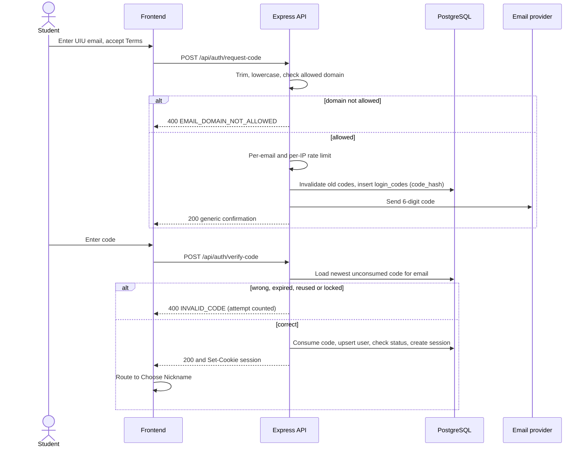
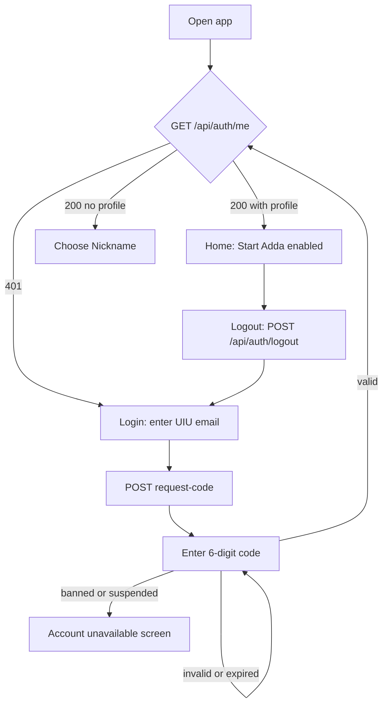
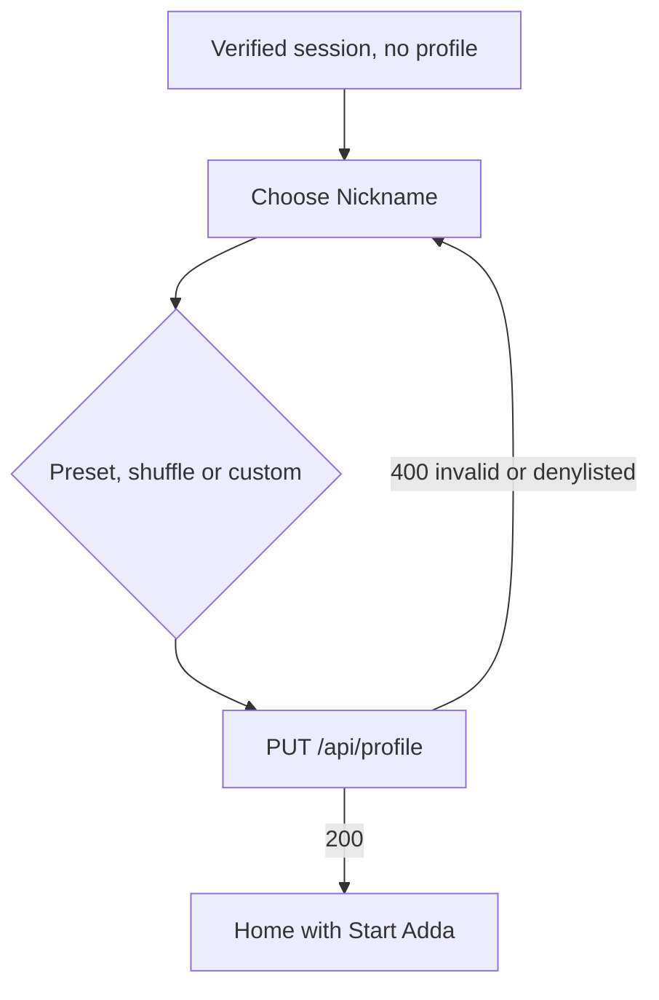
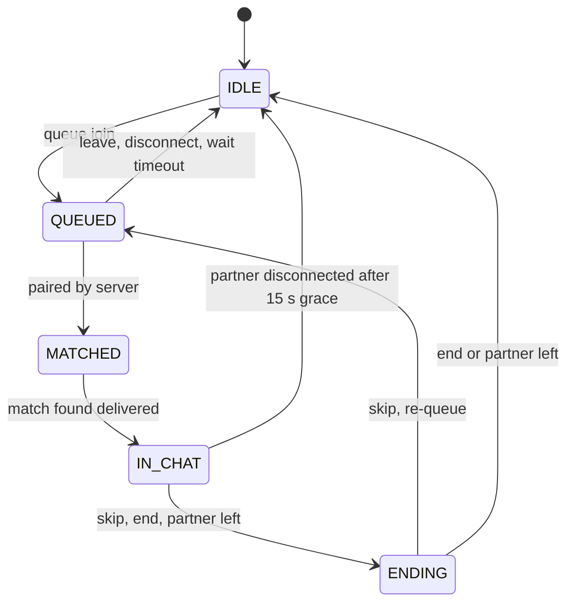
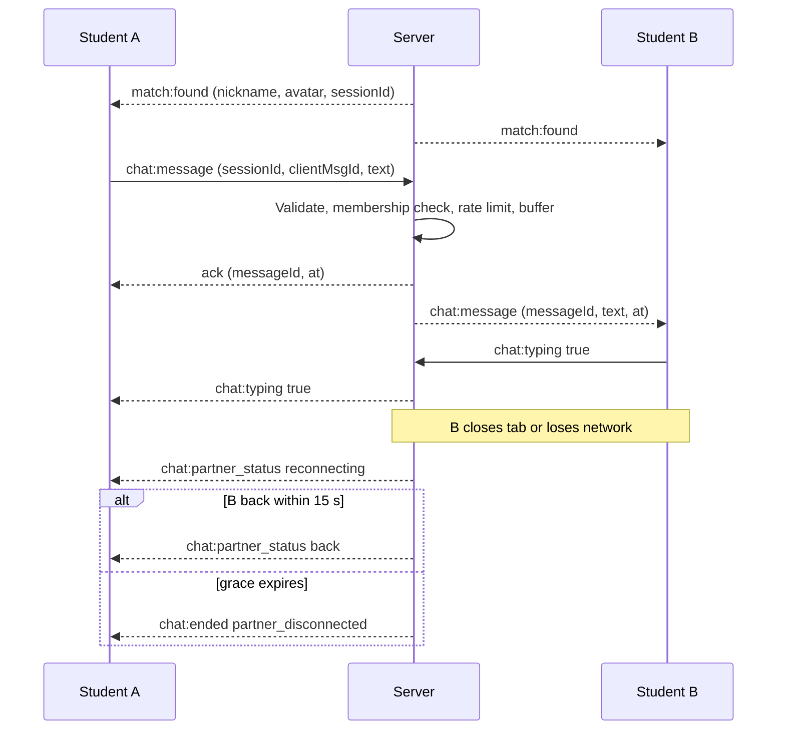
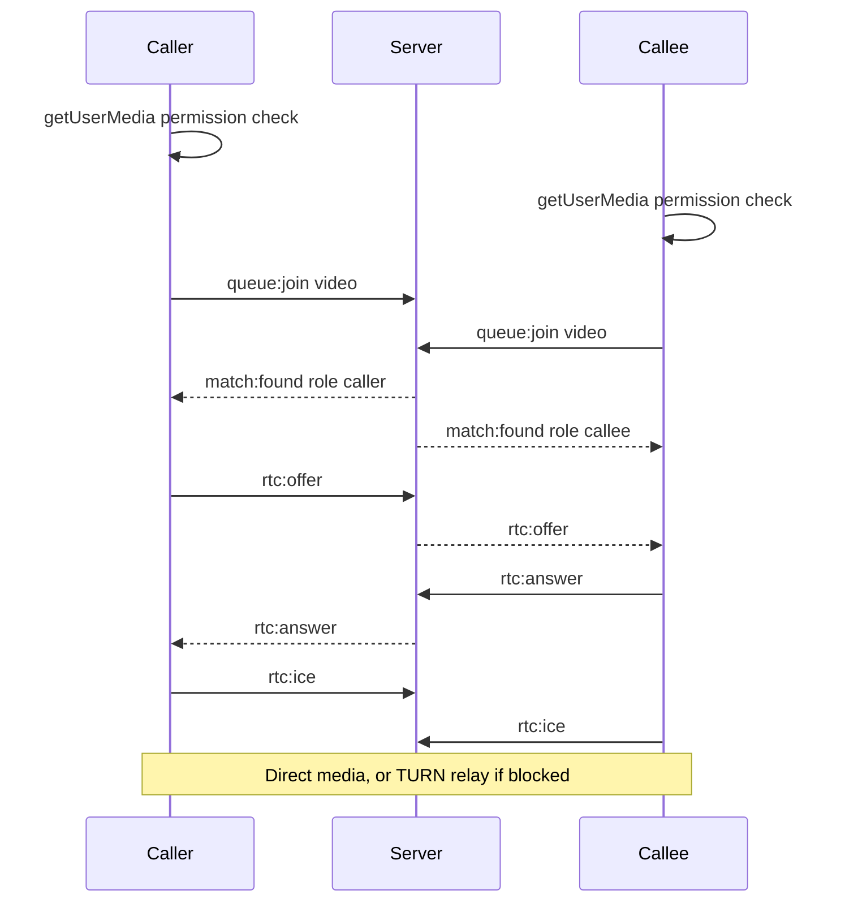
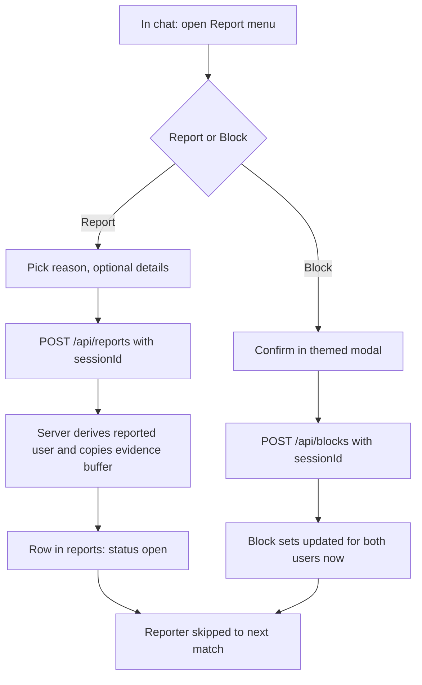
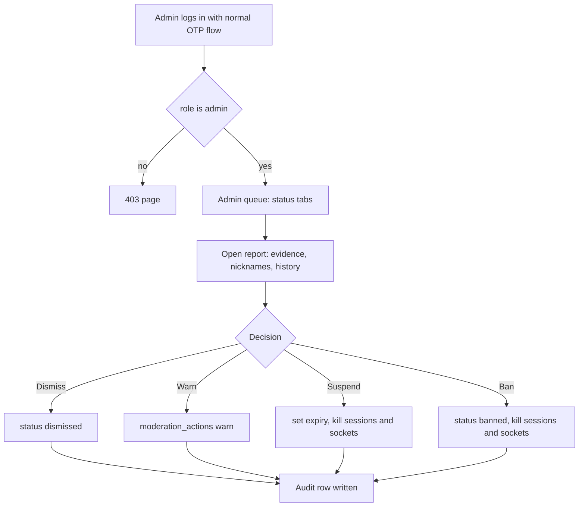

# KothaKoi — App Flow: User Journeys and State Machines

**Status:** Draft v0.1 — **[P] proposals; nothing approved.** Audit date 22 Oct 2026.
Tags: **[V]** verified in source · **[P]** proposed · **[A]** assumption · **[D OD-xx]** needs approval.

**Assumption used throughout:** passwordless email OTP (OD-01 default). Under the alternative (password + OTP) only FLOW-01 and FLOW-02 change; see the note after FLOW-02.

Flow IDs are referenced by REQUIREMENTS-TRACEABILITY.

---

## FLOW-01 Registration and UIU email OTP verification (first-time student)

With passwordless auth, registration is implicit: the first successful code verification creates the account. `Register.tsx` and `Login.tsx` therefore share one backend flow.

**Current UI [V]:** `Register.tsx` validates a client regex, shows a "Mock UI" OTP box, accepts any code of 4+ characters, offers an **Auto-fill** shortcut, and `handleSubmit` never checks `isEmailVerified`; it ends with `alert()` then `navigate('/choose-nickname')`. Nothing reaches a server.
**Failure paths:** domain rejected · rate limited (429, retry-after) · code invalid/expired/locked · email delivery failure (generic error, user may resend) · account banned (revealed only after a correct code, see EC-05).

## FLOW-02 Login and session authentication (returning student)

**Current UI [V]:** `Login.tsx` accepts a UIU email or a 7–10 digit student ID plus any non-empty password, shows a success banner, then navigates to `/choose-nickname` after 600 ms. Quick-fill buttons prefill a demo password. Student-ID login cannot be resolved without a roster or the department subdomain **[A]**, so it is dropped under passwordless.

> **If OD-01 = password + OTP at registration:** FLOW-01 gains password creation and `Register.tsx` keeps its fields. FLOW-02 becomes identifier + password, and needs password hashing (argon2/bcrypt), a reset flow, and change-password. That is more backend and more security surface; the existing Forgot/Change-password modals become real features.

## FLOW-03 First-time onboarding and nickname selection

**Current UI [V]:** 10 presets (emoji + tagline + colour), sequential shuffle, custom input (`maxLength` 24, fallback "Anonymous UIUian"), header "Step 2 of 2", hard-coded demo identity in the privacy callout, then `navigate('/chat')` with no state passed. Returning-user behaviour (ask every login vs once) **[D OD-07]**.

## FLOW-04 Matchmaking queue lifecycle

Server-persistent states: IDLE, QUEUED, IN_CHAT. "Matched" and "Ending" are brief UI-only states.

Rules [P]: server sets QUEUED before searching (double-click safe); pairing is a synchronous block with no `await` between finding and removing a candidate; exclusions are self, blocked either way, and recent-partner cooldown [D OD-13]; one active socket per user [P: newest wins].
**Current UI [V]:** none. "Next" reloads the page.

## FLOW-05 Text chat session

**Current UI [V]:** `Chat.tsx` and `Video.tsx` hold messages in local state and fake replies on a 1.2 s timer. The typing indicator is simulated.
UI states needed: sending / sent / failed per message; reconnecting banner; partner-left banner with **Find next**.

## FLOW-06 Video call (Release 2)

Rules [P]: permission is requested before joining the video queue; only the server-assigned caller sends the offer; early ICE candidates are buffered; on failure one ICE restart then a clear failure state; on end, stop all tracks and close the peer connection. **Current UI [V]:** none of this exists (`Video.tsx` is a visual mock).

## FLOW-07 End chat, skip and next-match transitions

| Action | Initiator UI [V existing] | Initiator ends in | Partner sees | Notes |
|---|---|---|---|---|
| Next / Skip | "Next" button, Esc | QUEUED (re-queued) | `partner_skipped` → IDLE | Pair added to cooldown [D OD-13] |
| End | "End" button (currently `confirm()` then `/`) | IDLE | `partner_left` → IDLE | No re-queue |
| Report & Next | Report menu/modal | QUEUED | `partner_skipped` | Report is submitted before the skip |
| Block & Next | "Block Student" | QUEUED | `partner_skipped` | Block set updated immediately |
| Partner disconnects | none | stays in room during grace | "reconnecting" then `partner_disconnected` | 15 s grace |
| Self refresh/reconnect | none | resumes room if inside grace | n/a | Server sends session state and recent buffer on reconnect [P] |
| Ban/suspend mid-chat | none | kicked to unavailable screen | `partner_left` | FR-23 |

Esc currently triggers Next in both `Chat.tsx` and `Video.tsx` even while the report modal or menu is open **[V bug]**; interaction model **[D OD-08]**.

## FLOW-08 Reporting and blocking

**Current UI [V]:** report reasons differ (`Chat.tsx`: Inappropriate Talk/Video; `Video.tsx`: nudity/harassment/spam); no details field; `alert()` confirmations; block only in `Chat.tsx`.

## FLOW-09 Profile and settings management

1. Open Profile (guarded) → `GET /api/profile` + `GET /api/auth/me`.
2. Shows email (private), verification state, nickname with link to change it, preferences.
3. Toggle preference → `PUT /api/profile` (preferences) → success/failure feedback.
4. Logout → `POST /api/auth/logout` → `/login`.
5. Delete account (danger zone, new) → confirm → `DELETE /api/account` → `/` **[D OD-12]**.

**Current UI [V]:** demo identity (Tanvir Ahmed, 2310125), fabricated statistics, five mock toggles (one with inverted label/variable), simulated change-password modal, `window.confirm` logout that only navigates.

## FLOW-10 Admin moderation workflow

Unban is done from a user view (not a report) **[P addition]**. Warn delivery to the user (in-app notice at next login) **[D OD-11]**. **Current UI [V]:** none.

---

## Edge cases and exception handling

| ID | Situation | Expected behaviour | Req |
|---|---|---|---|
| EC-01 | Partner closes tab mid-chat | "Reconnecting" for 15 s, then `partner_disconnected` with Find next | FR-15 |
| EC-02 | Own network drops mid-chat | Offline banner; auto-reconnect; resume if within grace, else clean ended state | FR-16 |
| EC-03 | OTP expired / reused / 6th wrong attempt | Generic `INVALID_CODE`; lock on 6th attempt; user must request a new code | FR-03 |
| EC-04 | OTP requests flooded (email bombing) | 429 with retry-after; no extra email | FR-19 |
| EC-05 | Banned user logs in | Generic response to request-code (no mail revealing status); after a *correct* code verifies, "account unavailable" screen with contact path | FR-06 |
| EC-06 | Suspended user with expiry | Same screen showing expiry; auto-restores after expiry | FR-06 |
| EC-07 | Same account in two tabs | Newest socket wins; older tab shows "opened elsewhere" | FR-10 |
| EC-08 | Double-click Find / double Skip | Second call ignored (`ALREADY_BUSY` / idempotent) | FR-10, FR-14 |
| EC-09 | Empty queue | Waiting state with cancel; optional timeout message "nobody online" **[D OD-13]** | FR-10, FR-30 |
| EC-10 | Message after room ended | Rejected `NOT_IN_SESSION`; UI shows ended state | FR-12 |
| EC-11 | Message > 1000 code points / empty | Rejected client-side and server-side | FR-12 |
| EC-12 | Duplicate `clientMsgId` (retry) | Ignored; original ack re-sent | FR-12 |
| EC-13 | Report after partner left | Allowed within the evidence window **[D OD-11]**; otherwise `SESSION_EXPIRED` | FR-17 |
| EC-14 | Report/block the same session twice | De-duplicated / idempotent | FR-17, FR-18 |
| EC-15 | Server restarts during chats | All rooms end; clients receive `session:state` IDLE after reconnect; open `chat_sessions` rows closed with `server_restart` | NFR-07 |
| EC-16 | Session cookie expires mid-chat | Socket disconnect with `UNAUTHENTICATED` → login | FR-04 |
| EC-17 | Admin route as non-admin | 403 page, no data | FR-05 |
| EC-18 | Camera/mic denied or busy (R2) | Named message + retry; user not queued | FR-24 |
| EC-19 | ICE failure (R2) | One restart, then Failed state with Next | FR-27 |
| EC-20 | Esc pressed with a modal/menu open | Closes the overlay first; does not skip **[D OD-08]** | FR-14 |
| EC-21 | Unknown URL | 404 page with link home | FR-30 |
