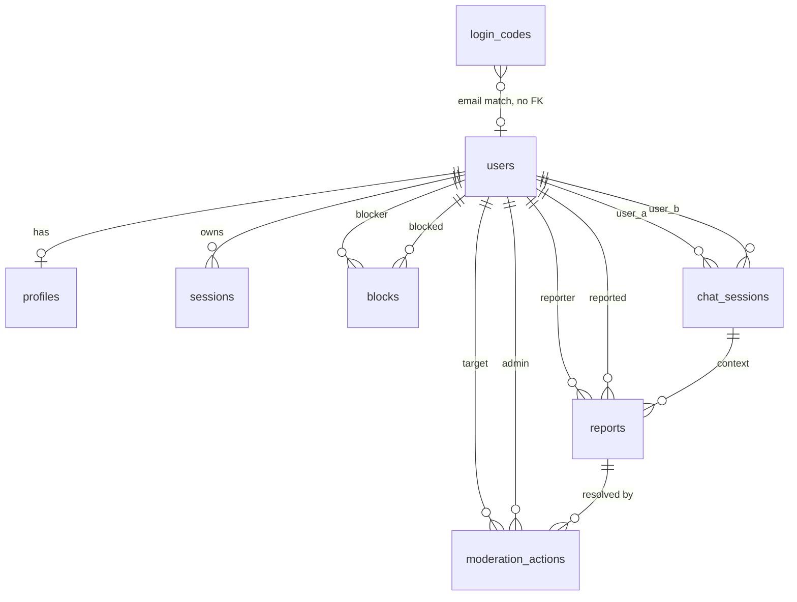

# KothaKoi — Backend Schema and Data Integrity

**Status:** Draft v0.1 — **design proposal; nothing approved, no schema or migration exists.** Audit date 22 Oct 2026.
Tags: **[V]** verified · **[P]** proposed · **[A]** assumption · **[D OD-xx]** needs approval.

**Verified starting point [V]:** there is no database client, no Prisma schema, no migrations, no Postgres container; `DATABASE_URL` is commented out in `.env.example`.

---

## 1. Technology evaluation **[D OD-03]**

| Requirement | PostgreSQL + Prisma **(proposed)** | Alternatives considered |
|---|---|---|
| Relational integrity (blocks, reports, sessions) | Native FKs, composite PK, enums, jsonb, `text[]` | SQLite: simple but weak for concurrent writes and hosted ops; MongoDB: loses FK integrity |
| Strict constraints | Unique/FK/enum are first-class. **CHECK constraints are not expressible in `schema.prisma`**; they must be added as raw SQL in a migration (`blocker_id <> blocked_id`, nickname length) | Drizzle / Kysely + `pg` express more SQL directly but need more hand-written SQL |
| Migrations | `prisma migrate dev` / `deploy`, committed migration files | Drizzle Kit, node-pg-migrate |
| Readability for a beginner-led team | Good (declarative schema, typed client) | Raw SQL: more control, more risk |
| Hosting | Any managed Postgres | n/a |

**Conclusion [P]:** Postgres + Prisma is a reasonable fit; the CHECK-constraint caveat means constraints need a small raw-SQL migration and a test (UT-SCHEMA). Approval required before Phase 1.

**Conventions [P]:** UUID PKs (`gen_random_uuid()`, Postgres ≥ 13); `timestamptz` everywhere; lowercase-normalised email enforced in application code (or `citext`); snake_case columns, mapped by Prisma.

## 2. Entity relationship diagram



`login_codes` deliberately has **no FK**: codes exist before a user row exists.

## 3. Tables

### 3.1 `users`
| Column | Type | Constraints / notes |
|---|---|---|
| `id` | uuid | PK |
| `email` | text | NOT NULL, **UNIQUE**, normalised (trim+lowercase) |
| `role` | enum(`student`,`admin`) | default `student` |
| `status` | enum(`active`,`suspended`,`banned`) | default `active` |
| `suspended_until` | timestamptz | NULL; **[P addition]** to avoid recomputing from actions |
| `email_verified_at` | timestamptz | NULL until first verified login |
| `terms_accepted_at` | timestamptz | **[P addition]** consent record (Register has a consent checkbox [V]) |
| `real_name` | text | **Conditional, [D OD-05].** Recommended default: **omit**. Unverified self-declaration if kept |
| `student_id` | text | **Conditional, [D OD-05].** Recommended default: omit; if kept, indexed, unverified |
| `created_at`, `updated_at`, `last_login_at` | timestamptz | |

### 3.2 `profiles`
| Column | Type | Notes |
|---|---|---|
| `user_id` | uuid | PK and FK → `users.id` **ON DELETE CASCADE** |
| `current_nickname` | text | NOT NULL; CHECK length 2–20 code points [P; UI input currently allows 24] ; uniqueness policy [D OD-07] |
| `avatar_preset` | text | key of the preset emoji/colour (e.g. `mango`) |
| `interests` | text[] | Plan §4.1 includes it (≤5); **no UI exists** → leave out until interest-matching is approved [P] |
| `preferences` | jsonb | e.g. `{ autoShuffleNickname, defaultMuted, defaultCamOff, avoidRematch }`; schema validated in API (zod) |
| `updated_at` | timestamptz | |

*Naming note: planning prompt uses `current_nickname`; the plan uses `nickname`. This set of documents uses `current_nickname`.*

### 3.3 `login_codes`
| Column | Type | Notes |
|---|---|---|
| `id` | uuid | PK |
| `email` | text | indexed with `created_at` |
| `code_hash` | text | HMAC-SHA256 with `OTP_HMAC_SECRET`; **never the plain code** |
| `expires_at` | timestamptz | ~10 min |
| `attempts` | int | default 0; lock at 5 |
| `consumed_at` | timestamptz | NULL until used |
| `created_at` | timestamptz | |

### 3.4 `sessions` **[replaced if OD-04 chooses an express-session store]**
| Column | Type | Notes |
|---|---|---|
| `id` | uuid | PK |
| `user_id` | uuid | FK → `users.id` CASCADE |
| `token_hash` | text | **UNIQUE**; SHA-256 of a 32-byte random token; cookie holds the raw token |
| `expires_at`, `last_seen_at`, `created_at` | timestamptz | |

### 3.5 `chat_sessions` (metadata only)
| Column | Type | Notes |
|---|---|---|
| `id` | uuid | PK; also the opaque `sessionId` sent to clients |
| `mode` | enum(`text`,`video`) | |
| `user_a_id`, `user_b_id` | uuid | FK → `users.id`; CHECK `user_a_id <> user_b_id`; delete behaviour [D OD-12] (proposal: `SET NULL`, so moderation context survives account deletion) |
| `started_at`, `ended_at` | timestamptz | `ended_at` NULL while active |
| `ended_reason` | enum | **[P]** neutral values: `skip`, `end`, `disconnect_timeout`, `moderation`, `server_restart`; plus `ended_by_user_id` NULL |

*Event payloads use per-user wording (`partner_skipped`, `you_ended`…); the table stores the neutral cause.*

### 3.6 `blocks`
| Column | Type | Notes |
|---|---|---|
| `blocker_id`, `blocked_id` | uuid | FK → `users.id` CASCADE; **composite PK**; CHECK `blocker_id <> blocked_id` |
| `created_at` | timestamptz | |

Clients never see user IDs, so block/unblock is addressed via `sessionId` or an opaque block reference (TRD §6) [D OD-11].

### 3.7 `reports`
| Column | Type | Notes |
|---|---|---|
| `id` | uuid | PK |
| `reporter_id`, `reported_id` | uuid | FK → `users.id`; `reported_id` is **derived server-side** |
| `chat_session_id` | uuid | FK → `chat_sessions.id`; **ON DELETE SET NULL** so retention can prune sessions |
| `reason` | enum | single unified list [D OD-11]; proposed: `harassment`, `sexual_content`, `hate_speech`, `spam_or_bot`, `impersonation`, `threats_or_self_harm`, `other` |
| `details` | text | ≤ 500 chars |
| `evidence` | jsonb | snapshot, see §5 |
| `status` | enum(`open`,`reviewing`,`actioned`,`dismissed`) | |
| `created_at`, `resolved_at` | timestamptz | |
| `resolved_by` | uuid | FK admin, NULL **[P addition]** |

UNIQUE `(reporter_id, chat_session_id)` for de-duplication [P].

### 3.8 `moderation_actions`
| Column | Type | Notes |
|---|---|---|
| `id` | uuid | PK |
| `admin_id`, `target_user_id` | uuid | FK → `users.id` |
| `report_id` | uuid | FK NULL (unban or direct action) |
| `action` | enum(`warn`,`suspend`,`ban`,`unban`,`dismiss`) | *Planning prompt lists no `unban`; the plan does. `unban` is included.* |
| `reason` | text | required |
| `expires_at` | timestamptz | for `suspend` |
| `created_at` | timestamptz | |

## 4. Indexes and unique constraints

| Index / constraint | Purpose |
|---|---|
| `users(email)` UNIQUE | account identity |
| `sessions(token_hash)` UNIQUE | session lookup on every request and socket handshake |
| `sessions(user_id)`, `sessions(expires_at)` | revoke-all on ban; cleanup |
| `login_codes(email, created_at)` | latest-code lookup, rate-limit audit |
| `blocks(blocker_id, blocked_id)` PK + `blocks(blocked_id)` | loading both directions of a user's block set before queueing |
| `chat_sessions(started_at)` | retention job |
| `chat_sessions(user_a_id)`, `chat_sessions(user_b_id)` | report ownership checks |
| `reports(status, created_at)` | admin queue |
| `reports(reported_id)` | prior-reports count / flagging |
| `reports(reporter_id, chat_session_id)` UNIQUE | de-duplication |
| `moderation_actions(target_user_id, created_at)` | user history |

## 5. Privacy boundaries and ephemeral data

**Never persisted:** message history, plaintext OTPs/tokens, passwords (if OD-01 = OTP-only), media, IP addresses (beyond in-memory rate-limit counters).
**Held in server memory only [P]:** matching queues, per-user state (IDLE/QUEUED/IN_CHAT), room state, per-room message buffer (last ~20), typing state, rate-limit counters, in-memory block sets, recent-partner cooldown map, and (proposed) a short **report window** of ended-room buffers [D OD-11].

**Consequence of memory-only state:** a server restart ends all rooms. On boot the server closes any `chat_sessions` row with `ended_at IS NULL` as `server_restart`.

**Report evidence JSON [P]** (contains no user IDs or emails):
```json
{
  "capturedAt": "2026-10-22T10:00:00Z",
  "reporterNickname": "Cha-er Cup",
  "reportedNickname": "Pixel Panda",
  "messages": [
    { "at": "2026-10-22T09:58:02Z", "from": "reported", "text": "..." }
  ]
}
```

**Admin visibility:** admins can see the reported user's email in the report detail (disclose in the Privacy Policy). Real name/student ID, if collected, are visible only there.

## 6. Retention and pruning **[D OD-12]**

| Data | Proposed rule |
|---|---|
| `login_codes` | delete when `expires_at` is older than 24 h |
| `sessions` | delete expired rows daily |
| `chat_sessions` | delete rows older than 30 days **unless** referenced by an open/reviewing report (or set report FK NULL) |
| `reports.evidence` | null out N days after resolution [P: 90 days; your decision] |
| `reports`, `moderation_actions` | keep for audit; period undecided |
| Account deletion | cascade profile/sessions/blocks; keep minimal ban-enforcement data (e.g., email hash) so deletion cannot be used to evade a ban **[D OD-12]** |

A scheduled job runs daily; first run in dry-run mode (TASK-HARD-01).

## 7. Integrity tests (UT-SCHEMA) **[P]**
Duplicate email rejected · self-block rejected · self-chat session rejected · deleting a user cascades to profile/sessions/blocks · duplicate report per (reporter, session) rejected · nickname length CHECK enforced.

## 8. Deviation log

| Topic | Planning prompt | Plan (`kothaKoiPlan.md`) | This document |
|---|---|---|---|
| Nickname column | `current_nickname` | `nickname` | `current_nickname` |
| Interests | not listed | `interests[]` | omitted (no UI) |
| Preferences JSONB | listed | not listed | included |
| `real_name`, `student_id` | listed | not listed | conditional on OD-05 |
| `unban` action | missing | present | present |
| `suspended_until`, `terms_accepted_at`, `resolved_by`, `ended_by_user_id` | n/a | n/a | proposed additions |
