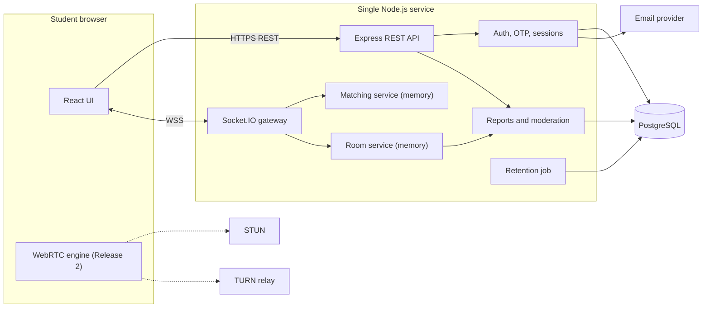

# KothaKoi — Technical Requirements Document (TRD)

**Status:** Draft v0.1 — **the stack and designs below are proposals pending approval (OD-03, OD-04, OD-09, …); none is confirmed.** Audit date 22 Oct 2026.
Tags: **[V]** verified in source · **[P]** proposed · **[A]** assumption · **[D OD-xx]** needs approval.

---

## 1. System architecture **[P]**

Services are plain classes (`MatchingService`, `RoomService`, `AuthService`, …) that know nothing about Express or Socket.IO, so they are unit-testable. Routes and socket handlers are thin.

## 2. Stack proposal **[all D OD-03 unless noted]**

| Layer | Proposed | Status |
|---|---|---|
| Frontend | React 18 + Vite 5 + TypeScript + Tailwind 3 + React Router 6 **[V existing]** | existing, keep |
| Backend | Node + Express 4 + TypeScript on **one service** **[V existing base]** | existing base |
| Real-time | Socket.IO attached to the same `http.Server` (`server.ts` already creates `http.createServer(app)` **[V]**) | Pending |
| DB / ORM | PostgreSQL + Prisma | Pending |
| Validation | zod, shared by server and client | Pending; **sharing needs a repo-level decision**, see §14 |
| Auth | Passwordless email OTP [D OD-01] + sessions [D OD-04] | Pending |
| Email | console in dev; transactional provider in prod [D OD-14] | Pending |
| Video | native WebRTC + Socket.IO signaling + STUN/TURN (Release 2) [D OD-16] | Pending |
| Tests | Vitest, Playwright | Pending |
| CI | GitHub Actions | Pending |

Pragmatism rule: no Redis, queues, microservices or Kafka for the pilot; single instance.

## 3. API conventions **[P]**

- JSON only; all routes under `/api`; state-changing routes require `Content-Type: application/json` and a valid `Origin`.
- Success: resource JSON. Failure: `{ "error": { "code": "STRING_CODE", "message": "human text", "details": {} } }` with matching HTTP status.
- Validation: every body/query validated with zod; unknown fields rejected.
- Auth: cookie session; identity never taken from request bodies.
- Pagination: cursor-based for admin lists.
- **Error codes:** `VALIDATION_FAILED`, `EMAIL_DOMAIN_NOT_ALLOWED`, `INVALID_CODE`, `RATE_LIMITED`, `UNAUTHENTICATED`, `FORBIDDEN`, `ACCOUNT_UNAVAILABLE`, `NOT_FOUND`, `ALREADY_BUSY`, `NOT_IN_SESSION`, `SESSION_EXPIRED`, `CONFLICT`, `INTERNAL`.

## 4. UIU email domain verification

Config: `ALLOWED_EMAIL_DOMAINS=uiu.ac.bd` (comma-separated). **Confirm real address formats with actual UIU mailboxes before coding** (UI examples use `…@bscse.uiu.ac.bd` **[V in UI copy]**) **[D OD-06]**.

Algorithm **[P]**:
1. `trim()`, lowercase; reject empty, whitespace inside, or length > 254.
2. Require **exactly one** `@`; local part non-empty, ASCII, matches a conservative pattern; domain ASCII only (reject non-ASCII/IDN homographs).
3. Reject a trailing dot.
4. Accept iff `domain === allowed` **or** `domain.endsWith('.' + allowed)` for some allowed entry.
5. Never use substring/`includes`/unanchored regex.

| Input | Result |
|---|---|
| `2310125@bscse.uiu.ac.bd` | accept |
| `A@UIU.AC.BD` | accept (normalised) |
| `  a@uiu.ac.bd  ` | accept (trimmed) |
| `a@uiu.ac.bd.evil.com` | reject |
| `a@evil-uiu.ac.bd` | reject (`endsWith('.uiu.ac.bd')` false) |
| `a@notuiu.ac.bd` | reject |
| `a@uiu.ac.bd.` | reject |
| `a@b@uiu.ac.bd` | reject |
| `a uiu.ac.bd` | reject |

The existing client regex **[V]** is anchored and subdomain-aware, so it is a fair UX pre-check, but it is **not** a security control. The server check is authoritative (UT-EMAIL).

## 5. Authentication and sessions **[P]**

**OTP:** `crypto.randomInt` 6 digits; stored as HMAC (`OTP_HMAC_SECRET`); TTL 10 min; ≤5 attempts; single use; new request invalidates older codes; resend cooldown 60 s; per-email 5/hour; per-IP 20/hour (shared campus IPs argue for also keying by email) — **tuning values are proposals**.
**Response uniformity:** `request-code` returns the same success body whether or not the account exists or is banned; ban status is revealed only after a correct code (EC-05).
**Sessions [D OD-04]:**
- *Option A (plan):* random 32-byte token in cookie `kothakoi_session`, SHA-256 hash stored in `sessions`; lookup per request/socket handshake; revoke on logout/ban.
- *Option B (existing code):* keep `express-session` but replace the default store with a Postgres store; share the middleware with Socket.IO.
- Cookie flags: `HttpOnly`, `Secure` in production, `SameSite=Lax` (plan). Repo currently sets `strict` in production **[V]**; with a same-origin deployment (OD-09) Lax or strict both work for same-site flows; choose deliberately.
- Behind a proxy set `trust proxy` so `Secure` cookies and client IPs work.
- Session lifetime: repo uses 24 h `maxAge` **[V]**; length [D OD-04].
- `requireAuth` re-checks `users.status` on each request.

## 6. REST endpoints **[P]**

| Endpoint | Request | Success | Errors | Req |
|---|---|---|---|---|
| `GET /api/health` **[V exists, returns `{status:'ok'}`; plan says `{ok:true}`]** | – | 200 | – | – |
| `POST /api/auth/request-code` | `{ email, acceptTerms? }` | 200 generic | 400 domain/validation, 429 | FR-01,02,19 |
| `POST /api/auth/verify-code` | `{ email, code }` | 200 user summary + cookie | 400 `INVALID_CODE`, 403 `ACCOUNT_UNAVAILABLE` | FR-03,06 |
| `POST /api/auth/logout` | – | 204 | – | FR-04 |
| `GET /api/auth/me` | – | `{ id, role, hasProfile, status }` (own data only) | 401 | FR-04,05 |
| `GET /api/profile` | – | nickname, avatarPreset, preferences | 401 | FR-07,08 |
| `PUT /api/profile` | `{ nickname?, avatarPreset?, preferences? }` | profile | 400, 401 | FR-07,08 |
| `DELETE /api/account` | – | 204 | 401 | FR-09 |
| `POST /api/blocks` | `{ sessionId }` | 204 | 403/404 if not a participant | FR-18 |
| `GET /api/blocks`, `DELETE /api/blocks/:blockRef` | opaque refs | – | – | [D OD-11] |
| `POST /api/reports` | `{ sessionId, reason, details? }` | `{ reportId }` | 403, 404, 409 dup, 429 | FR-17 |
| `GET /api/ice-servers` | – | short-lived STUN/TURN creds | 401 | FR-27 (R2) |
| `GET /api/admin/reports?status=&cursor=` | – | list | 403 | FR-21 |
| `GET /api/admin/reports/:id` | – | detail + evidence + history | 403, 404 | FR-21 |
| `POST /api/admin/reports/:id/action` | `{ action, reason, expiresAt? }` | updated report | 400, 403, 409 | FR-22 |
| `POST /api/admin/users/:id/action` | `{ action: 'unban'…, reason }` | – | 403 | FR-22 **[P addition]** |

## 7. Socket.IO contract **[P; names follow the plan, additions marked Δ]**

Auth: handshake reads the session cookie; `socket.data.userId` set server-side; clients never send a user ID. Reject unauthenticated/banned. Origin checked. `maxHttpBufferSize` capped (e.g. 16 KB). Newest connection per user replaces the older one [D: plan allows either].

| Dir | Event | Payload | Notes |
|---|---|---|---|
| C→S | `queue:join` | `{ mode: 'text' \| 'video' }` | ack `{ ok }` or error |
| C→S | `queue:leave` | `{}` | |
| C→S | `chat:message` | `{ sessionId, clientMsgId, text }` | 1–1000 code points; ack `{ ok, messageId, at }` |
| C→S | `chat:typing` | `{ sessionId, isTyping }` | throttled |
| C→S | `chat:skip` / `chat:end` | `{ sessionId }` | |
| C→S | `rtc:offer/answer/ice` | `{ sessionId, sdp \| candidate }` | R2; size-capped |
| S→C | `session:state` Δ | `{ state: 'IDLE'\|'QUEUED'\|'IN_CHAT', session?, recent? }` | sent on connect/reconnect; enables resume |
| S→C | `queue:waiting` | `{}` | |
| S→C | `match:found` | `{ sessionId, mode, role, partner: { nickname, avatarPreset } }` | **no email/ID/interests-with-IDs** |
| S→C | `chat:message` | `{ sessionId, messageId, text, at }` | |
| S→C | `chat:typing` | `{ sessionId, isTyping }` | |
| S→C | `chat:partner_status` Δ | `{ sessionId, status: 'reconnecting' \| 'back' }` | grace period UX |
| S→C | `chat:ended` | `{ sessionId, reason: 'partner_skipped' \| 'partner_left' \| 'partner_disconnected' \| 'you_ended' \| 'moderation' }` | |
| S→C | `rtc:*` | relayed unchanged, only to partner | R2 |
| S→C | `error` | `{ code, message }` | |

Every `chat:*`/`rtc:*` event verifies that `sessionId` is an active in-memory session and that `socket.data.userId` is one of its two participants (`FORBIDDEN` otherwise). Relay to the partner only; never broadcast.

## 8. Matching algorithm and concurrency **[P]**

- In-memory FIFO queues per mode; per-user state map IDLE / QUEUED / IN_CHAT.
- **Pairing is one synchronous block with no `await`** between choosing a candidate and removing it from the queue. Block sets and cooldown maps are loaded/updated in memory beforehand; the `chat_sessions` insert happens **after** pairing (asynchronously).
- Exclusions: self; blocked in either direction; recent-partner cooldown **10 minutes [P, D OD-13]**.
- On skip: pair enters cooldown; skipper re-queued; partner → IDLE.
- On disconnect: remove from queue immediately; if IN_CHAT start 15 s grace timer, rebind on reconnect, else end room.
- Stale-entry sweep every 30 s; optional maximum wait [D OD-13].
- Room lifecycle: created on pairing; per-room buffer (last 20 messages) for reports; deleted on end; ended-room buffer kept in a short **report window** (e.g. 10 min) [D OD-11].
- Single-instance only; Redis + adapter is the documented scale-out path, not in MVP.

## 9. Rate limits and flood control **[P values]**

| Surface | Limit |
|---|---|
| `request-code` | per email 5/h; per IP 20/h; 60 s resend cooldown |
| `verify-code` | 5 attempts per code; per-IP 30/h |
| `queue:join` | 10/min per user |
| `chat:message` | burst 5 per 3 s, 60/min per user |
| `chat:typing` | 1 per second |
| `POST /api/reports` | 5/h per user |
| General REST | per-IP and per-user buckets |

Exceeding limits → HTTP 429 or socket `RATE_LIMITED` in the standard error shape. Counters are in memory (reset on restart; acceptable for a pilot).

## 10. WebRTC signaling and STUN/TURN **[P, Release 2; D OD-16, OD-17]**

SDP offer/answer and ICE candidates relayed per FLOW-06. Server assigns `caller`/`callee`. Public STUN in development; production TURN via a managed provider or self-hosted `coturn`, with **short-lived credentials issued by `GET /api/ice-servers`**; TURN secrets only in server env. Cap video near 640×360 @ 30 fps and a modest bitrate. `getUserMedia` needs HTTPS or localhost. Direct peer connections can expose each peer's public IP; relay-only mode removes that at higher cost.

## 11. Security and threat model **[P]**

| Threat | Mitigation |
|---|---|
| Domain bypass | Parsed domain match (§4); server authoritative |
| OTP brute force / email bombing | Hash at rest, attempt cap, TTL, rate limits |
| Session theft/fixation | HttpOnly/Secure/SameSite, hashed tokens, rotate on login, revoke on ban/logout |
| CSRF / socket hijack | SameSite, JSON-only mutations, Origin checks on REST and handshake |
| XSS | Render as text; no `dangerouslySetInnerHTML`; `helmet` + CSP (must allow Google Fonts or self-host) |
| Room impersonation | Membership check on every event; opaque UUID session IDs |
| Spam/flooding | Limits §9; socket buffer cap |
| Data leakage | Partner payloads limited; PII-free logs (pino with redaction); no emails in sockets |
| Secrets in repo | `.env` ignored **[V]**; secret scan in CI/review |
| Admin abuse | `requireAdmin` server-side; every action audited; admin email access logged |
| Server restart | Documented loss of rooms; clean client state |

## 12. Testing strategy **[P]**

Vitest unit tests (email parser, OTP, `MatchingService`, rate limiter) · integration tests against a real test Postgres (auth, profile, reports, admin, retention, schema) and a socket harness (handshake, chat, membership) · Playwright E2E with two browser contexts · manual matrix for permissions, networks, phones · load script (50–200 sockets). Test IDs are listed in REQUIREMENTS-TRACEABILITY §3.

## 13. Deployment blueprint **[P, D OD-09, OD-18]**

One Node service serving the built frontend and `/api` + `/socket.io` on the same origin (removes CORS/cross-site cookie issues), managed Postgres, HTTPS via host. Start: `prisma migrate deploy` then server. `NODE_ENV=production`, trust proxy, WebSocket support verified, staging first, DB backup before deploys, region as close to Bangladesh as providers allow. Docker is optional.

**Environment variables**

| Variable | Current [V `.env.example`] | Proposed |
|---|---|---|
| `SESSION_SECRET` | present | keep (if OD-04 B) or replace |
| `PORT` | 5000 | keep |
| `NODE_ENV` | development | keep |
| `CLIENT_ORIGIN` | `http://localhost:3000` | keep (dev); unneeded if same-origin |
| `DATABASE_URL` | commented | enable |
| `OTP_HMAC_SECRET`, `ALLOWED_EMAIL_DOMAINS`, `EMAIL_PROVIDER`, `EMAIL_API_KEY`, `EMAIL_FROM` | absent | add |
| `ADMIN_EMAILS` | absent | **[P]** bootstrap admins [D OD-11] |
| `TURN_URL`, `TURN_SECRET` | absent | R2 |

## 14. Gap analysis: repo vs plan vs prompt **[V]**

| Topic | Repo | Plan | Resolution needed |
|---|---|---|---|
| Folder names | `frontend/`, `backend/` | `client/`, `server/`, `shared/` | Keep repo names; decide how to share `shared/` |
| Shared contracts | none; backend `tsconfig` has `rootDir: ./src` and `include: ["src/**/*"]`; frontend `include: ["src"]` — a sibling `shared/` cannot be imported without config changes | `shared/events.ts`, `api.ts`, `errors.ts` | npm workspaces / path aliases / duplication [D OD-03] |
| Ports | FE 3000, BE 5000 | 5173 / 3000 | Repo wins; plan snippets need adjusting |
| Deployment shape | CORS + separate origins in dev (`/api` proxy only) | single origin serving built FE | [D OD-09] |
| `/socket.io` proxy (`ws: true`) | **missing** in `vite.config.ts` | required | TASK-RT-02 |
| Session | `express-session`, default memory store, cookie `connect.sid`, `sameSite: strict` in prod | custom hashed-token sessions, Lax | [D OD-04] |
| Health response | `{ status: 'ok' }` | `{ ok: true }` | pick one, document |
| Scripts | FE: dev/build/preview/typecheck; BE: dev/build/start/typecheck. **No lint/test** | lint/typecheck/test/build | TASK-FND-02 |
| Node version | not pinned (no `engines`/`.nvmrc` seen) | Node LTS | TASK-FND-02 |
| TypeScript | `^5.5.x` range; lockfiles resolve 5.9.3 | – | informational |
| Build artifacts | `*.tsbuildinfo` files appear in the supplied files and are not in `.gitignore` | – | confirm whether tracked; ignore |
| Auth model | password UI | passwordless OTP | [D OD-01] |
| Release order | video-first UI | text first | [D OD-02] |
| Plan modules done | Module 0 partial · 1 partial (scaffolds exist; no root dev script seen) · 2 not done · 3 UI done but not componentised · 4–16 not started | | see IMPLEMENTATION-PLAN §2 |
